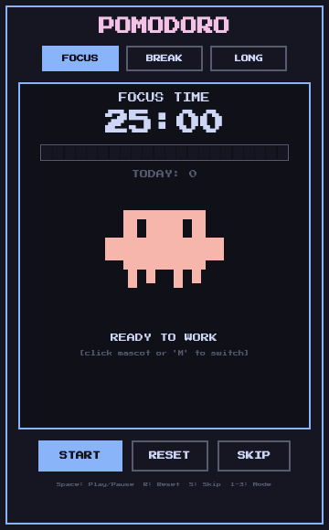

# Pomopixel

**A retro pixel-art Pomodoro timer designed natively for Omarchy and Wayland.**



Pomopixel combines classic 8-bit arcade aesthetics with a distraction-free productivity timer. Built in C++17 and Qt 6 Quick, it runs as a lightweight, floating Wayland window that tracks your Omarchy system theme live.

---

## Features

- **Live Omarchy Theme Sync**: Watches `~/.local/state/omarchy/current/theme/colors.toml` and Hyprland's rounding live. Switching your system theme instantly updates the app's palette without restarting.
- **32×32 Pixel Mascots**: Animated pixel companions that keep you company during work and sleep peacefully during breaks:
  - **Claude Critter**: The iconic orange pixel creature with walking and sleeping animations.
  - **Dumpling Blob**: The cozy pink tamagotchi with sleepy closed eyes and blushing cheeks.
  - **Linux Tux**: Classic retro penguin typing on a mini glowing laptop during focus sessions.
  - **Arcade Ghost**: Pac-Man style ghost that looks around during focus and turns vulnerable blue when resting.
- **Warm 8-Bit Audio**: Synthesized gentle chiptune chimes (triangle/sine waves with smooth attack/decay) with full volume control and support for custom audio files.
- **Desktop Notifications**: Dispatches native notifications via `notify-send` when focus or break intervals complete.
- **Keyboard-First Control**: Drive the entire timer from your keyboard without touching the mouse.
- **Zero Overhead**: Compiled into a single, compact C++ binary using minimal system memory.

---

## Keyboard Shortcuts

| Shortcut | Action |
|---|---|
| <kbd>Space</kbd> | Start / Pause timer |
| <kbd>R</kbd> | Reset current session |
| <kbd>S</kbd> | Skip to next phase |
| <kbd>1</kbd> | Switch to **Focus** mode |
| <kbd>2</kbd> | Switch to **Short Break** mode |
| <kbd>3</kbd> | Switch to **Long Break** mode |
| <kbd>M</kbd> | Cycle through mascots |
| <kbd>Q</kbd> / <kbd>Esc</kbd> | Close window |

---

## Configuration

Settings are stored in `~/.config/pomopixel/config.json` and reload **live on save**:

```json
{
    "durations": {
        "focus": 25,
        "short_break": 5,
        "long_break": 15,
        "long_break_interval": 4
    },
    "mascot": "claude_critter",
    "sound": {
        "enabled": true,
        "volume": 0.2,
        "finish_sound": "",
        "start_sound": "",
        "click_sound": ""
    },
    "notifications": true,
    "behavior": {
        "auto_start_breaks": false,
        "auto_start_focus": false
    },
    "theme": {
        "use_omarchy_theme": true,
        "custom_accent": ""
    },
    "window": {
        "width": 360,
        "height": 580,
        "always_on_top": false
    }
}
```

### Options

- **`durations`**: Minutes for `focus`, `short_break`, `long_break`, and cycles before a long break.
- **`mascot`**: Active mascot (`"claude_critter"`, `"blob"`, `"tux"`, `"ghost"`).
- **`sound.volume`**: Output volume between `0.0` and `1.0`.
- **`sound.*_sound`**: Custom sound path (`.wav`, `.mp3`) or empty string for built-in chiptune.
- **`theme.custom_accent`**: Override the Omarchy accent color with a custom hex code (e.g. `"#FF79C6"`).

---

## Building and Testing

### Prerequisites

On Arch Linux / Omarchy:

```bash
omarchy pkg add base-devel qt6-base qt6-declarative qt6-quickcontrols2 qt6-wayland pipewire
```

### Build

```bash
./bin/build
```

### Test

Runs the offscreen Qt test suite:

```bash
./bin/test
```

### Install

Installs the binary to `~/.local/bin`, the desktop file to `~/.local/share/applications`, and icons for the Omarchy app launcher (`Super + Space`):

```bash
./bin/install
```

To build a system Arch Linux package:

```bash
cd pkgbuild && makepkg -fsi
```

---

## License

[MIT](LICENSE) © 2026 floper
