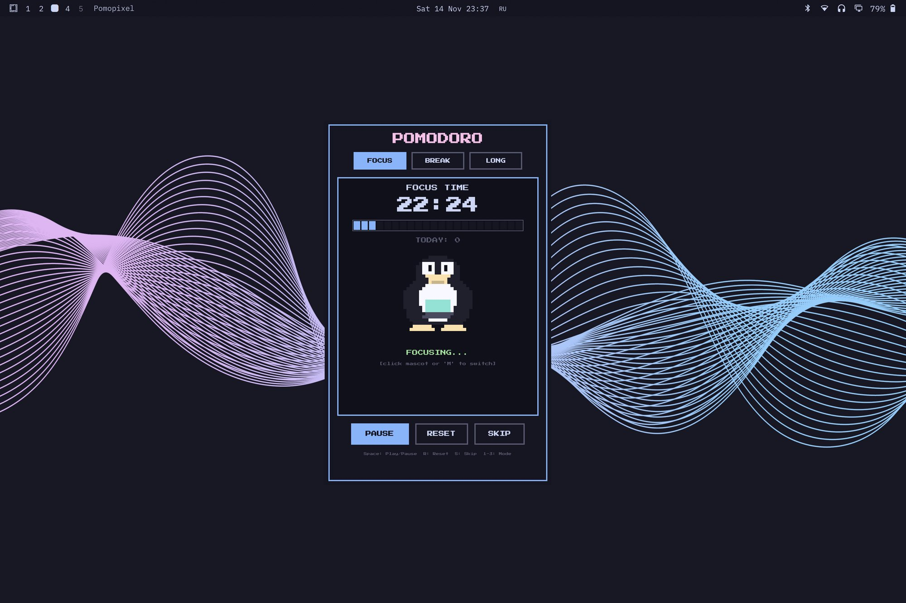

<div align="center">

# Pomopixel

**A retro pixel-art Pomodoro timer designed natively for [Omarchy](https://omarchy.org) and Wayland.**

<p align="center">
  <a href="https://plugins.omarchy.org"></a>
  <a href="LICENSE"></a>
  
  
</p>

<p align="center">
  
</p>

</div>

---

## Overview

**Pomopixel** combines classic 8-bit arcade aesthetics with a distraction-free productivity timer. Built entirely in modern C++17 and Qt 6 Quick, it runs as a lightweight, floating Wayland window with zero background bloat. 

It functions both as a **standalone desktop application** (launched via `Super + Space`) and as an **Omarchy status bar widget**.

---

## Key Highlights

* **Live Omarchy Theme Sync**: Watches `~/.local/state/omarchy/current/theme/colors.toml` and Hyprland's window rounding live. Switching your system theme in Omarchy instantly recolors the timer without restarting.
* **Detailed 32×32 Pixel Mascots**: Expressive, animated pixel companions with distinct work and rest states:
  * 🦊 **Claude Critter**: The iconic terracotta creature with stepping feet in focus and sleeping horizontal slits with `z Z Z` on rest.
  * 🌸 **Dumpling / Pink Cat**: The cozy pastel blob with shiny specular highlights, perky ears, and sleeping closed eyes.
  * 🐧 **Linux Tux**: Classic retro penguin typing on a mini glowing laptop during focus sessions.
  * 👻 **Arcade Ghost**: Pac-Man style ghost looking around during work, turning vulnerable blue with wavy mouth during breaks.
* **Warm 8-Bit Chiptune**: Soft, pleasant retro chimes synthesized with gentle triangle/sine waves and smooth 15ms envelopes (no harsh clicks or buzzing). Includes native volume scaling and custom audio file support.
* **Desktop Notifications**: Dispatches native notifications via `notify-send` when focus or break intervals finish.
* **Keyboard-First**: Full keyboard control without needing to touch the mouse.
* **Zero Overhead**: Single native binary compiled with `qmake6` + `g++`. Minimal CPU and RAM footprint.

---

## Quick Start & Installation

### Option 1: Omarchy Plugin Marketplace (Recommended)

Install directly via the Omarchy plugin manager:

```bash
omarchy plugin add https://github.com/fl0p3r/pomopixel --enable
```

To update to the latest release:

```bash
omarchy plugin update pomopixel
```

To uninstall:

```bash
omarchy plugin remove pomopixel
```

---

### Option 2: Build from Source (Multi-Distro)

#### Arch Linux / Omarchy / Manjaro / EndeavourOS

Install build dependencies:
```bash
sudo pacman -S --needed base-devel qt6-base qt6-declarative qt6-quickcontrols2 qt6-wayland pipewire
```

Clone and install:
```bash
git clone https://github.com/fl0p3r/pomopixel.git
cd pomopixel
./bin/build
./bin/install
```
*(Or build with PKGBUILD: `cd pkgbuild && makepkg -si`)*

#### Fedora / RHEL / Nobara

Install dependencies:
```bash
sudo dnf install gcc-c++ make qt6-qtbase-devel qt6-qtdeclarative-devel qt6-qtquickcontrols2-devel pipewire-utils
```

Clone and build:
```bash
git clone https://github.com/fl0p3r/pomopixel.git
cd pomopixel
./bin/build
./bin/install
```

#### Ubuntu / Debian / Linux Mint / Pop!_OS

Install dependencies:
```bash
sudo apt update
sudo apt install build-essential qt6-base-dev qt6-declarative-dev qml6-module-qtquick-controls libgl-dev pipewire-bin
```

Clone and build:
```bash
git clone https://github.com/fl0p3r/pomopixel.git
cd pomopixel
./bin/build
./bin/install
```

---

## Keyboard Shortcuts

| Shortcut | Action |
|---|---|
| <kbd>Space</kbd> | Start / Pause timer |
| <kbd>R</kbd> | Reset current session |
| <kbd>S</kbd> | Skip to next phase |
| <kbd>1</kbd> | Switch to **Focus** mode (default 25 min) |
| <kbd>2</kbd> | Switch to **Short Break** mode (default 5 min) |
| <kbd>3</kbd> | Switch to **Long Break** mode (default 15 min) |
| <kbd>M</kbd> | Cycle through mascots (*Claude*, *Blob*, *Tux*, *Ghost*) |
| <kbd>Q</kbd> / <kbd>Esc</kbd> | Close window |

---

## Configuration

Settings are saved in `~/.config/pomopixel/config.json`. The file is created automatically on first run and **reloads live upon saving**:

```json
{
    "durations": {
        "focus": 25,
        "short_break": 5,
        "long_break": 15,
        "long_break_interval": 4
    },
    "mascot": "claude_critter",
    "sound": {
        "enabled": true,
        "volume": 0.2,
        "finish_sound": "",
        "start_sound": "",
        "click_sound": ""
    },
    "notifications": true,
    "behavior": {
        "auto_start_breaks": false,
        "auto_start_focus": false
    },
    "theme": {
        "use_omarchy_theme": true,
        "custom_accent": ""
    },
    "window": {
        "width": 360,
        "height": 580,
        "always_on_top": false
    }
}
```

### Configuration Details

* **`durations`**: Duration in minutes for each phase, plus how many focus cycles trigger a long break.
* **`mascot`**: Choose between `"claude_critter"`, `"blob"`, `"tux"`, or `"ghost"`.
* **`sound.volume`**: Output volume between `0.0` (mute) and `1.0` (max).
* **`sound.*_sound`**: Absolute path to custom `.wav` / `.mp3` files, or `""` for built-in 8-bit chiptune.
* **`theme.custom_accent`**: Override system accent with a custom hex color (e.g. `"#FF79C6"`).

---

## Testing

Run the offscreen automated Qt test suite:

```bash
./bin/test
```

---

## License

Distributed under the [MIT](LICENSE) License. © 2026 floper.
Part of the [Omarchy](https://omarchy.org) ecosystem.
